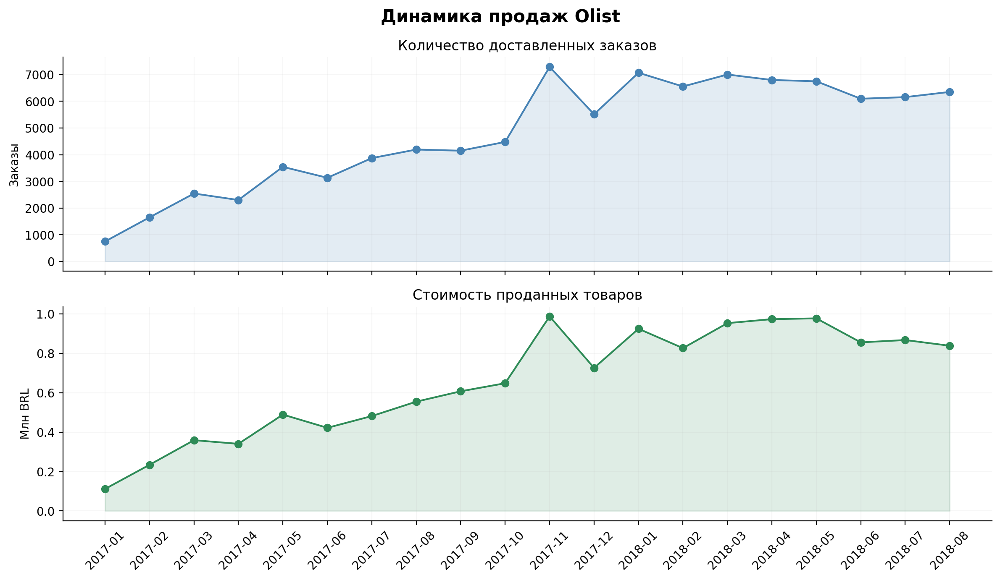
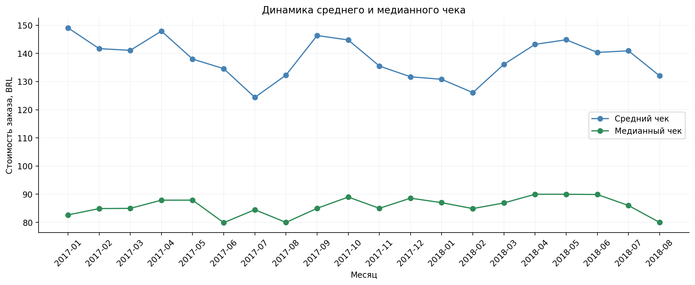
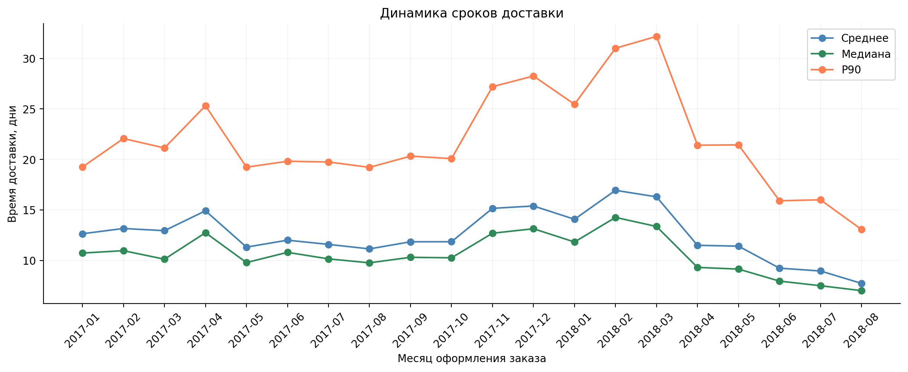
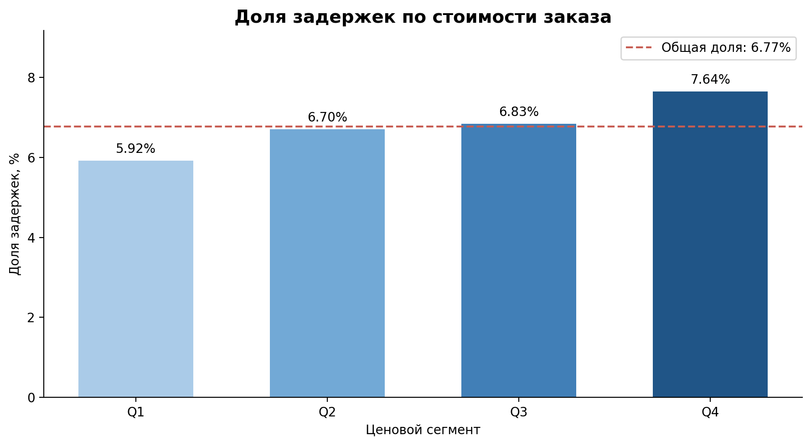
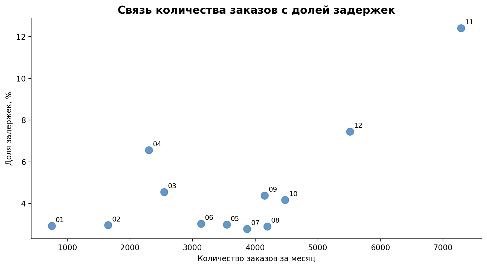

# Анализ продаж и качества доставки Olist

## О проекте

В этом проекте я проанализировала данные бразильского маркетплейса Olist: количество заказов, стоимость товаров и сроки доставки. Цель исследования — понять, как менялись основные показатели, насколько часто заказы доставлялись с опозданием и какие факторы могут быть связаны с задержками.

**Основные вопросы исследования:**

1. Как меняются количество заказов и средний чек?
2. Насколько своевременно доставляются заказы?
3. Связано ли качество доставки со стоимостью заказа?
4. Связано ли количество заказов с задержками доставки?

## Данные и инструменты

Использованы две таблицы из датасета **Olist**:

| Таблица | Содержание | Количество строк |
|---|---|---:|
| `olist_orders_dataset.csv` | Заказы, их статусы, даты оформления и доставки | 99 441 |
| `olist_order_items_dataset.csv` | Товарные позиции, стоимость товаров и доставки | 112 650 |

**Инструменты:** Python, Pandas, NumPy, Matplotlib, Jupyter Notebook / Google Colab.

В исходных данных 96 478 заказов имеют статус `delivered`. У 8 из них отсутствует дата получения, поэтому основной анализ выполнен для **96 470 доставленных заказов с известной датой доставки**.

## 1. Подготовка и проверка данных

Сначала я изучила структуру таблиц, проверила пропуски, дубликаты и статусы заказов, а также привела даты к нужному формату.

После этого объединила данные о заказах и товарах. Поскольку в одном заказе может быть несколько товаров, стоимость товарных позиций сначала суммируется по `order_id`. Это позволяет правильно рассчитывать средний чек и другие показатели на уровне заказа.

Также проверила уникальность идентификаторов заказов, наличие соответствующих товарных позиций и корректность дат. После объединения в исходной таблице товарных позиций для доставленных заказов содержится **110 189 строк**, относящихся к **96 470 уникальным заказам**.

## 2. Основные показатели

| Показатель | Результат |
|---|---:|
| Количество проанализированных заказов | 96 470 |
| Общая стоимость товаров без доставки | 13 220 248,93 BRL |
| Средний чек | 137,04 BRL |
| Средний срок доставки | 12,56 дня |
| Медианный срок доставки | 10,22 дня |
| 90-й перцентиль срока доставки (P90) | 23,10 дня |
| Доля заказов с опозданием | 6,77% |

**BRL** — бразильский реал. Стоимость товаров рассчитывается отдельно от стоимости доставки. Опозданием считается получение заказа позже обещанной календарной даты.

## 3. Динамика продаж по месяцам

Для анализа данные сгруппированы по месяцу оформления заказа. На первом графике сравниваются количество доставленных заказов и общая стоимость товаров, на втором — средний и медианный чек. Для временных графиков основной период начинается с января 2017 года, так как данные за 2016 год представлены лишь частично.

**Количество заказов и стоимость товаров.** В течение 2017 года оба показателя в целом увеличивались, а наиболее заметный рост наблюдался в ноябре. Их динамика похожа: когда заказов становится больше, обычно увеличивается и общая стоимость товаров.

**Средний и медианный чек.** В 2017–2018 годах средний чек в основном находился в пределах **125–150 BRL**, а медианный — около **80–90 BRL**. Средний чек заметно выше медианного, поскольку более дорогие заказы повышают среднее значение.

## 4. Оценка качества доставки

Средний срок доставки составил **12,56 дня**, медианный — **10,22 дня**. Максимальный срок достиг **209,63 дня**. Разница между средним и медианой показывает, что отдельные длительные доставки влияют на среднее значение.

**6,77%** заказов пришли позже обещанной даты. Среди опоздавших средняя задержка составила **10,62 дня**, медианная — **7 дней**.

На графике сроков доставки сравниваются среднее значение, медиана и P90. На протяжении большей части 2017 года среднее время доставки составляло около **11–13 дней**. В конце 2017 — начале 2018 года сроки увеличились, особенно среди наиболее долгих доставок: в феврале–марте 2018 года P90 достиг примерно **31–32 дней**.

P90 помогает увидеть изменения в самых длительных доставках, которые не всегда заметны по среднему значению.

## 5. Анализ бизнес-гипотез

### Гипотеза 1. Связь стоимости заказа с качеством доставки

Чтобы проверить гипотезу, я разделила заказы на четыре группы по стоимости товаров: от самых дешёвых (Q1) до самых дорогих (Q4).

| Показатель | Q1 — дешёвые заказы | Q4 — дорогие заказы |
|---|---:|---:|
| Средний срок доставки | 11,45 дня | 13,69 дня |
| Доля задержек | 5,92% | 7,64% |

С увеличением стоимости заказа растут и среднее время доставки, и доля опозданий. Гипотеза получила **предварительное подтверждение**: дорогие заказы в этой выборке доставлялись дольше и чаще опаздывали.

При этом нельзя утверждать, что задержки возникают именно из-за высокой стоимости: на доставку могут влиять расстояние до покупателя и особенности логистики.

### Гипотеза 2. Связь количества заказов с задержками

Для проверки я сравнила количество заказов и долю просроченных доставок по месяцам **2017 года**.

Устойчивой зависимости обнаружено не было: рост количества заказов не всегда сопровождался увеличением доли задержек. Однако в **ноябре 2017 года** число заказов достигло **7 288**, а доля опозданий — **12,40%**.

Таким образом, гипотеза **не получила однозначного подтверждения**. В отдельные месяцы высокая нагрузка совпадала с ростом задержек, но на сроки доставки могут влиять и другие факторы, в том числе сезонность.

## 6. Итоговые выводы и рекомендации

Анализ показал, что продажи Olist в течение 2017 года в целом росли, при этом стоимость заказов и качество доставки различались между группами и периодами. Особенно выделяются более длительные доставки дорогих заказов и высокая доля задержек в ноябре 2017 года.

На основе результатов можно предложить следующие рекомендации:

1. **Дополнительно изучить доставку дорогих заказов.** В этой группе сроки и доля опозданий выше, поэтому стоит выяснить, с чем связаны различия.
2. **Учитывать периоды повышенного спроса.** В пиковые месяцы стоит внимательнее следить за количеством заказов и качеством доставки.
3. **Отслеживать несколько показателей доставки.** Помимо среднего срока полезно смотреть медиану, P90 и долю задержек, чтобы не пропускать проблемы с долгими доставками.

### Ограничения исследования

- Анализ включает только доставленные заказы с известной датой получения; отменённые и недоставленные заказы не рассматриваются.
- Данные за 2016 год и часть 2018 года неполные, поэтому не все месяцы можно напрямую сравнивать.
- Найденные связи не доказывают, что один показатель является причиной изменения другого. Для более точных выводов понадобятся сведения о географии заказов, продавцах и логистике.
